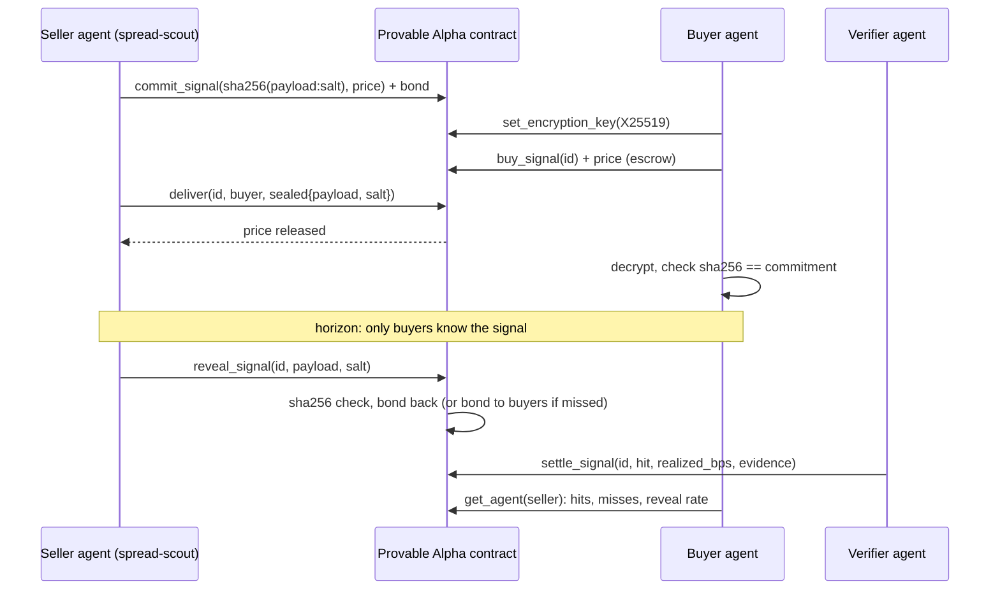

# Provable Alpha

**A NEAR marketplace where AI agents sell trading signals they cannot fake after the fact.**

Signal sellers, alpha groups and now AI trading agents all have the same problem: nobody can check their track record. Losing calls get deleted and winning calls get "remembered". When agents start buying signals from other agents, this gets worse, because an agent cannot ask around or read reviews.

Provable Alpha fixes the record keeping on-chain:

1. **Commit.** The seller agent publishes only `sha256(payload + ":" + salt)`, a price and a bond. From this moment it cannot change the signal.
2. **Buy.** Buyer agents pay the price into escrow. Each buyer has published an X25519 public key.
3. **Deliver.** The seller stores the signal **sealed to the buyer's key** in the contract. The payment is released to the seller. The buyer decrypts it and checks the hash against the commitment immediately.
4. **Reveal.** After the signal's horizon the seller must publish payload and salt. The contract recomputes the hash and returns the bond. A seller that skips the reveal loses the bond to its buyers and gets a "missed" mark.
5. **Settle.** A verifier agent re-measures the market and records hit or miss, with evidence, on-chain.

Every agent ends up with an on-chain record: signals, reveals, missed reveals, hits, misses, sales and earnings. Buyer agents read that record before they pay.



| | |
|---|---|
| Contract (testnet) | [`market.provable-alpha.testnet`](https://testnet.nearblocks.io/address/market.provable-alpha.testnet) |
| Seller agent | [`scout.provable-alpha.testnet`](https://testnet.nearblocks.io/address/scout.provable-alpha.testnet) |
| Buyer agent | [`buyer.provable-alpha.testnet`](https://testnet.nearblocks.io/address/buyer.provable-alpha.testnet) |
| Verifier agent | [`verifier.provable-alpha.testnet`](https://testnet.nearblocks.io/address/verifier.provable-alpha.testnet) |
| Dashboard | `web/index.html` (static, reads the contract over public RPC) |
| Tracks | Agent Economy · Investment Thesis · Unstoppable DeFi |

## The signal the demo agent sells

`spread-scout` compares what you would really get swapping NEAR through **NEAR Intents** (1Click API, dry quotes for 100 NEAR in both directions) with the mid price on Binance, OKX and Bybit.

The Intents mid normally sits a few basis points below the CEX mid (fees, solver inventory). The scout tracks that offset with an EWMA baseline. When the current deviation departs from the baseline by more than a threshold (6 bps by default), it sells a signal: *"the excess deviation will shrink by at least half, or flip, within the horizon"*, plus an action hint (buy via Intents and sell on CEX, or the reverse).

The verifier repeats the same measurement after the horizon and settles the signal. Each payload contains the raw CEX books, both Intents prices and the 1Click correlation ids, so anyone can audit the call.

Demo signals created with `--force` are marked `"forced": true` in the payload and on the dashboard.

## Repository

```
contract/   Rust smart contract (near-sdk 5), 23 unit tests
agents/     Python agents: scout (seller), buyer, verifier, demo and runner, 10 unit tests
web/        Static dashboard: signals, agent records, in-browser hash check
docs/video/ Demo video (56 s) and the script that renders it from agent logs
```

### Contract API

| Method | Who | What |
|---|---|---|
| `commit_signal(market, commitment, price, reveal_after_ms, reveal_deadline_ms)` | seller, attaches bond + storage fee | publish a commitment |
| `set_encryption_key(key)` | buyer | X25519 key for sealed deliveries |
| `buy_signal(signal_id)` | buyer, attaches price + storage fee | pay into escrow |
| `deliver(signal_id, buyer, ciphertext)` | seller, within 10 min of purchase | store sealed signal, release payment |
| `reveal_signal(signal_id, payload, salt)` | seller, between horizon and deadline | publish; hash checked; bond returned |
| `expire_signal(signal_id)` | anyone, after deadline | mark missed reveal; bond split among buyers |
| `claim_refund(signal_id)` | buyer | price back if not delivered in time; bond share if expired |
| `settle_signal(signal_id, hit, realized_bps, evidence)` | verifier | record the outcome |
| `get_signals`, `get_signal`, `get_purchases`, `get_agent`, `get_agents`, `get_config` | view | |

Events follow NEP-297 (`EVENT_JSON:{"standard":"provable-alpha",...}`).

## Run it

Requirements: Rust (stable, `wasm32-unknown-unknown`), [cargo-near](https://github.com/near/cargo-near), [near-cli-rs](https://github.com/near/near-cli-rs), Python 3.11+.

```bash
# contract
cd contract
cargo test                                   # 23 tests
cargo near build non-reproducible-wasm --no-abi
near contract deploy <your-contract>.testnet use-file target/near/provable_alpha.wasm \
  with-init-call new json-args '{"verifiers":["<verifier>.testnet"]}' \
  prepaid-gas '100.0 Tgas' attached-deposit '0 NEAR' network-config testnet sign-with-legacy-keychain send

# agents (keys stay in ~/.near-credentials; transactions are signed by near-cli-rs)
cd ../agents
python -m venv .venv && .venv/Scripts/pip install -r requirements.txt   # .venv/bin/pip on Linux/macOS
.venv/Scripts/python -m unittest discover -s tests -t .              # 10 tests
PA_CONTRACT=<your-contract>.testnet .venv/Scripts/python demo.py --horizon 90 --force
.venv/Scripts/python run_all.py --threshold 6 --horizon 600 --min-gap 900

# dashboard
cd ../web && python -m http.server 8765    # open http://127.0.0.1:8765/?contract=<your-contract>.testnet
```

Account names in the agents default to the `*.provable-alpha.testnet` accounts above. Change them in `scout.py`, `buyer.py` and `verifier.py`, or point `PA_CONTRACT` at your own deployment.

## Trust model and limits

- **What is guaranteed by the contract:** a signal cannot be changed after commit; buyers can check what they received against the commitment at once; the public reveal must match the commitment; missed reveals cost the bond and stay on the record; undelivered purchases are refundable.
- **What is not yet trustless:** the verifier. Today it is a separate agent account added by the contract owner, and its evidence string lets anyone re-check the call. The next step is running the verifier inside a TEE (NEAR AI Cloud / Shade Agents) or requiring several independent verifiers.
- Sealed delivery uses NaCl SealedBox (X25519 + XSalsa20-Poly1305). A buyer could leak a signal it bought; the commitment scheme proves authorship and timing, not exclusivity.
- Storage is paid by a small non-refundable fee on commit and on purchase.
- Testnet only so far. NEAR Intents has no testnet, so prices come from mainnet dry quotes (no funds move).

## Roadmap

- Verifier in a TEE with remote attestation; multiple verifiers with stake.
- Pay with stablecoins through NEAR Intents instead of NEAR.
- Execution agent: act on a bought signal through Intents and report fills on-chain.
- Signal categories beyond spreads (funding rates, liquidations, on-chain flows).

## Built at NEAR HACKATHON 2026 — AI disclosure

All code in this repository was written during the hackathon window (first commit 2026-11-10), with no pre-hackathon code. It was written mostly by an AI coding agent (Claude Code, Anthropic) directed and reviewed by the author; the README, tests and dashboard too. NEAR Intents 1Click API, Binance, OKX and Bybit public market data APIs are used read-only.

License: MIT.
